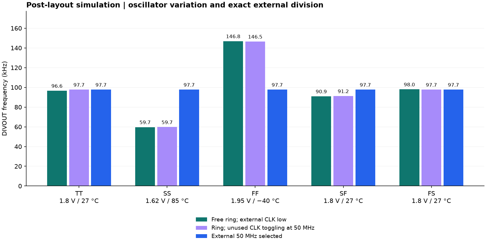
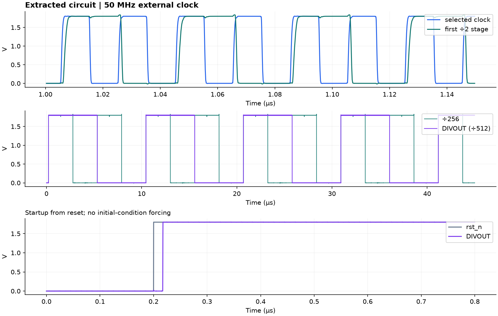
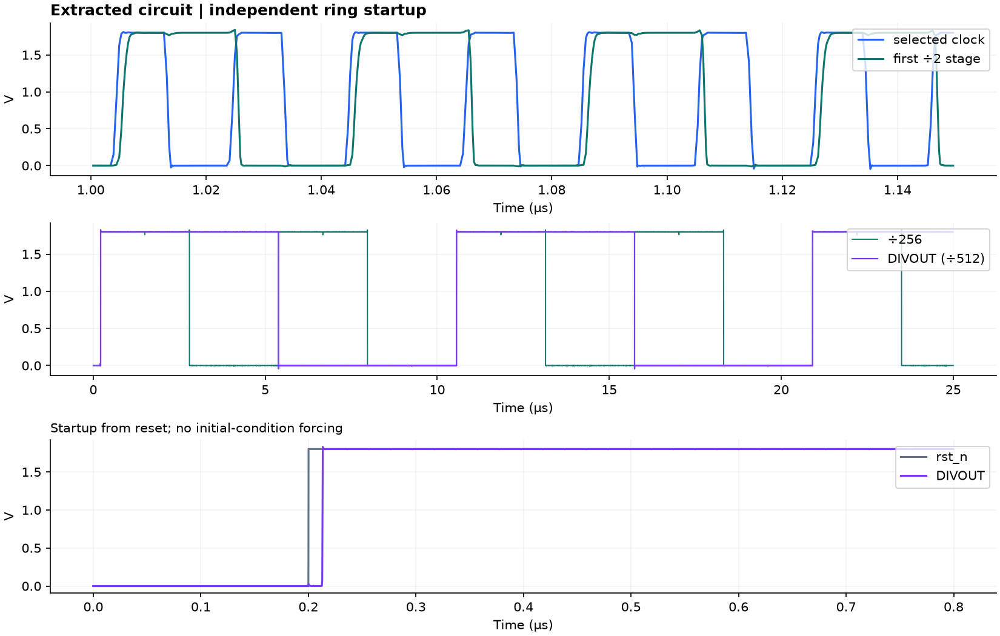
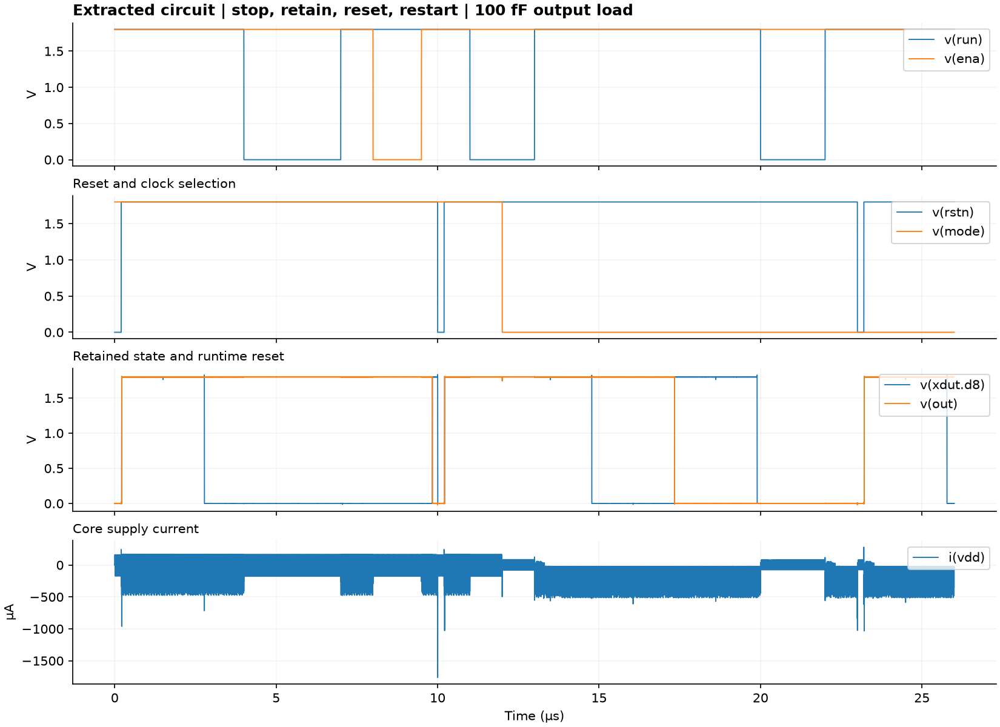

# Clock512 local verification

**Local engineering checks passed.** GitHub Actions, repository publication. The public author is **Zane Al Saadi**. silicon has been sent for fabricated, but will not be receving until June 2027 to measure for this project.

Target: TTSKY26d, SKY130, 1×2 tile, 161 × 225.76 µm, no analog pads. Physical top: `tt_um_clock512_custom`.

| Check | Result |
|---|---|
| Full Magic DRC, nine reusable cells plus top | 0 violations |
| Netgen LVS, nine cells plus top | Unique matches |
| Editable Xschem top compared with Magic extraction | Unique match |
| Xschem electrical-rule messages | No warnings or errors |
| Fresh GDS import: full DRC and LVS to top.sch | 0 violations; unique match |
| Magic antenna check | 0 feedback violations |
| Official Tiny Tapeout precheck, run locally | All checks passed |
| Metadata, LEF pins, GDS boundary, Verilog interface | Passed |
| Exact passive RC reduction | Terminal-current equivalence verified |
| Post-layout functional cases below | All completed and passed |

The official precheck results are in [precheck_results.md](precheck_results.md). Individual tool logs are retained. `artifact_checks.json` records hashes of the final submission files; `simulation_results.json` records the tested circuit hashes and numerical results.

## Post-layout simulation results

All cases include the extracted resistance and capacitance network and the pinned SKY130 transistor models. The nominal external-clock test uses the unreduced network. Other tests use an equivalent network with resistor-only internal nodes eliminated; all positive capacitances and device terminals are retained. A separate nodal-matrix comparison verifies the reduction.

Every period listed below contained **exactly 512 selected-clock rising edges**. Each output period also had one falling edge and a 45–55% high fraction. Initial reset, completion time, finite values, and simulator error logs were checked. The first partial cycle after reset was excluded.

| Test | Corner | Supply / temp | Output kHz | Periods checked | Mean core power µW |
|---|---|---|---:|---:|---:|
| external 50 MHz | TT | 1.8 V / 27 °C | 97.656 | 3 | 96.46 |
| ring, unused CLK toggling at 50 MHz | TT | 1.8 V / 27 °C | 97.656 | 2 | 159.16 |
| external 50 MHz | SS | 1.62 V / 85 °C | 97.656 | 2 | 78.49 |
| ring, unused CLK toggling at 50 MHz | SS | 1.62 V / 85 °C | 59.727 | 3 | 78.71 |
| external 50 MHz | FF | 1.95 V / -40 °C | 97.656 | 2 | 113.20 |
| ring, unused CLK toggling at 50 MHz | FF | 1.95 V / -40 °C | 146.484 | 2 | 290.84 |
| external 50 MHz | SF | 1.8 V / 27 °C | 97.656 | 2 | 97.09 |
| ring, unused CLK toggling at 50 MHz | SF | 1.8 V / 27 °C | 91.180 | 3 | 149.23 |
| external 50 MHz | FS | 1.8 V / 27 °C | 97.656 | 2 | 98.07 |
| ring, unused CLK toggling at 50 MHz | FS | 1.8 V / 27 °C | 97.656 | 3 | 163.61 |
| free ring | TT | 1.8 V / 27 °C | 96.596 | 1 | 158.85 |
| free ring | SS | 1.62 V / 85 °C | 59.709 | 1 | 78.78 |
| free ring | FF | 1.95 V / -40 °C | 146.848 | 1 | 292.49 |
| free ring | SF | 1.8 V / 27 °C | 90.927 | 1 | 149.17 |
| free ring | FS | 1.8 V / 27 °C | 98.006 | 1 | 164.14 |

External-clock tests use 50 fF at the tile output. The control sequence uses 100 fF and verifies four stop/retention intervals (including `ena` and a mode change), two runtime resets, and five restarts. All nine divider stages and the public output are checked during hold and reset intervals.

The free-ring tests hold the external `clk` at zero and demonstrate independent startup. Separate ring tests intentionally toggle the unused external clock to exercise parasitic coupling. That activity can alter or entrain the ring frequency; hold `clk` low to measure free-running frequency.

Power is the mean current from the ideal core supply multiplied by supply voltage, averaged after 1 µs. It excludes the Tiny Tapeout pad/multiplexer infrastructure and board power. Oscillator frequency is not a precision specification.

## Scope and reproducibility

These results cover the modeled conditions and stimuli listed above. They are not fabricated-silicon measurements, foundry acceptance, full-chip integration timing, package/pad simulation, statistical mismatch analysis, or electromigration/lifetime signoff.

The diode parameter conversion is explicit in [SIMULATION_UNITS.md](../docs/SIMULATION_UNITS.md). Raw exports and the exact qualified extracted network are retained. The original extraction used the container's open_pdks 1.0.599 technology; re-extraction with Tiny Tapeout's pinned PDK was compared as an attributed circuit graph. Resistor values, device parameters and topology match; capacitances differ only within a 3 ppm / 0.0001 fF text-rounding tolerance. See `extraction_provenance.json` and `extraction_equivalence.json`. All simulation transistor models, final DRC, final GDS checks, and official precheck use the pinned submission PDK.

`toolchain.lock.json` records tool versions and source references. `scripts/verify.sh` reruns physical checks and simulations. `scripts/rebuild.sh` first regenerates the schematic and layout. Raw waveform files are kept in the working environment and omitted from the source ZIP; the decks, numerical results, logs, and plots are included.
